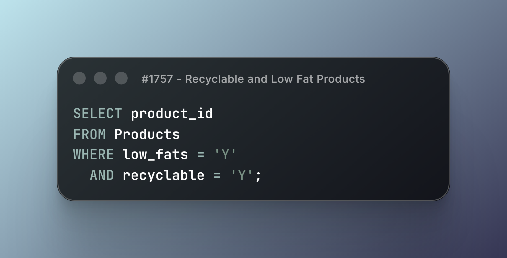
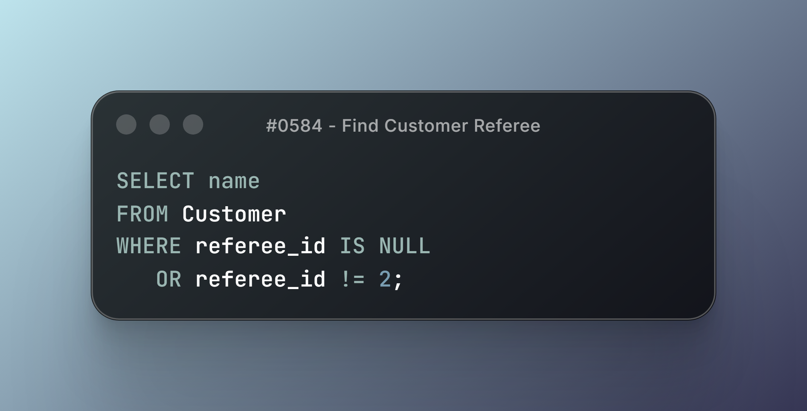
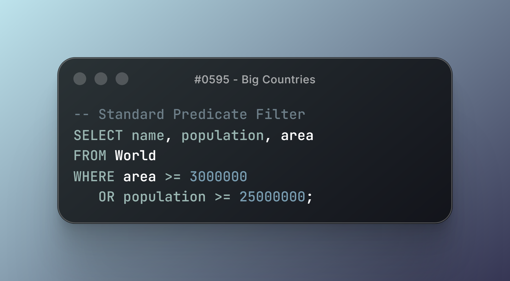
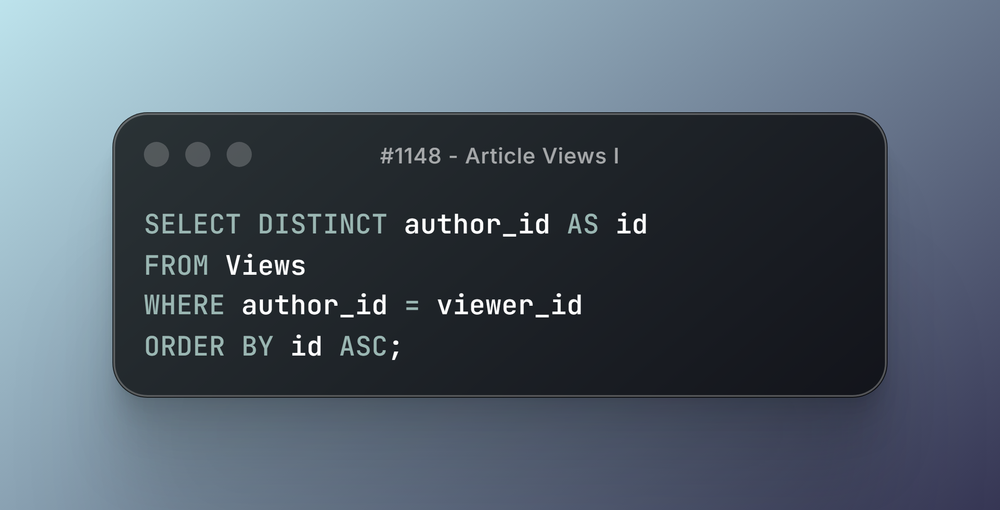
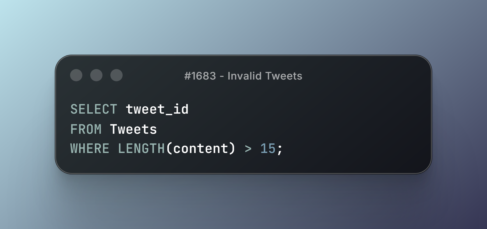

# LeetCode SQL 50 — Module 1: Basic Select

Focusing on fundamental query mechanics, Three-Valued Logic (3VL) semantics, string length evaluations, and predicate filtering costs in PostgreSQL.

---

## Technical Breakdown & Solutions

### 1. #1757 - Recyclable and Low Fat Products

- **Core Mechanics:** Boolean Predicate Filtering (`AND` logic).
- **Key Learning:** Under sequential scans, PostgreSQL checks both predicates per tuple. At scale, a Partial Index (`WHERE low_fats = 'Y' AND recyclable = 'Y'`) or Composite Index avoids full table scans entirely.

---

### 2. #0584 - Find Customer Referee

- **Core Mechanics:** Three-Valued Logic (3VL) & `NULL` Handling.
- **Key Learning:** Standard inequality operators (`!= 2`) evaluate to `UNKNOWN` when encountering `NULL`, silently dropping valid records. Explicit `IS NULL` conditions are non-negotiable for data accuracy.

---

### 3. #0595 - Big Countries

- **Core Mechanics:** Compound Predicate Optimization (`OR` evaluation).
- **Key Learning:** `OR` logic across multiple unindexed columns forces full sequential scans. PostgreSQL handles this via Bitmap Or Scans or requires query restructuring to utilize separate index scans.

---

### 4. #1148 - Article Views I

- **Core Mechanics:** Deduplication (`DISTINCT`) & Memory Footprint.
- **Key Learning:** `DISTINCT` executes via `HashAggregate` or `Unique` sorting in memory (`work_mem`). If execution memory is exceeded, PostgreSQL spills intermediate sorting operations to temporary disk files.

---

### 5. #1683 - Invalid Tweets

- **Core Mechanics:** Runtime String Evaluation (`LENGTH()`).
- **Key Learning:** `LENGTH()` evaluates byte/character length per row dynamically. Running unindexed string functions on high-cardinality tables introduces avoidable CPU runtime overhead.

---

## Module Status

- [x] Select (5/5)
- [ ] Basic Joins (0/9)
- [ ] Basic Aggregate Functions (0/8)
- [ ] Sorting and Grouping (0/7)
- [ ] Advanced Select and Joins (0/7)
- [ ] Subqueries (0/7)
- [ ] Advanced String Functions / Regex / Clause (0/7)
