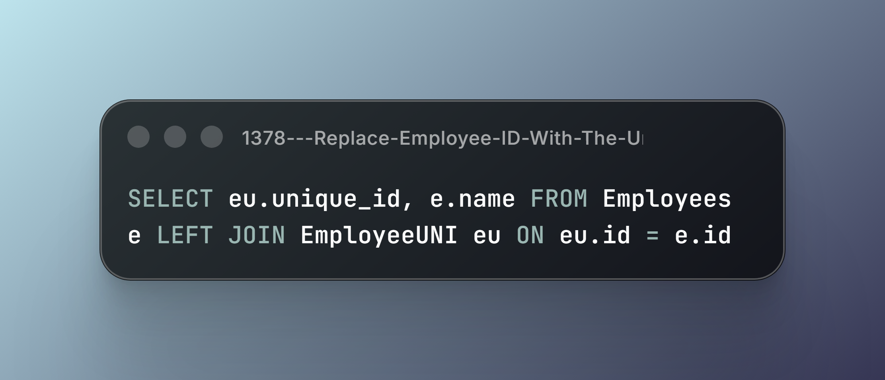
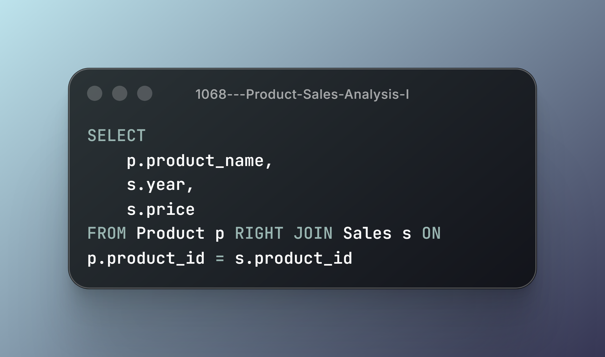
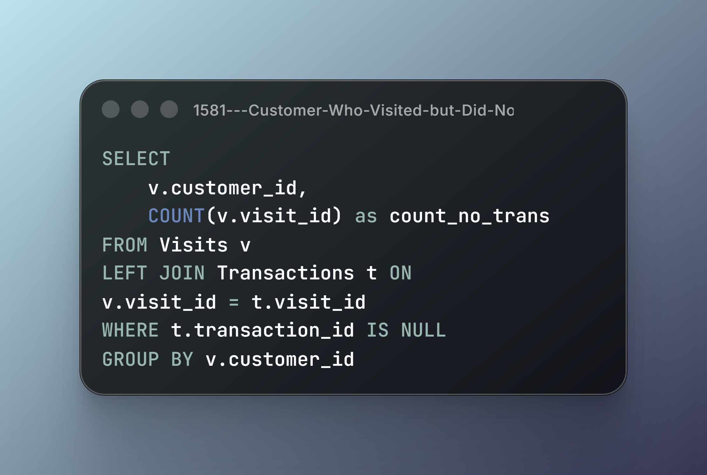
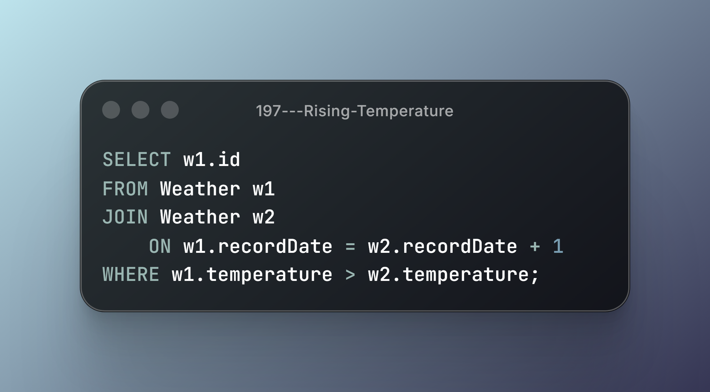
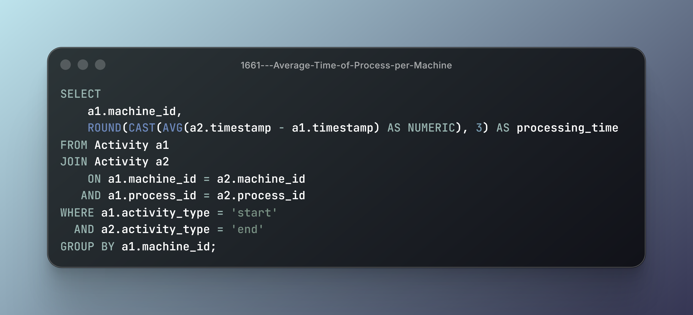
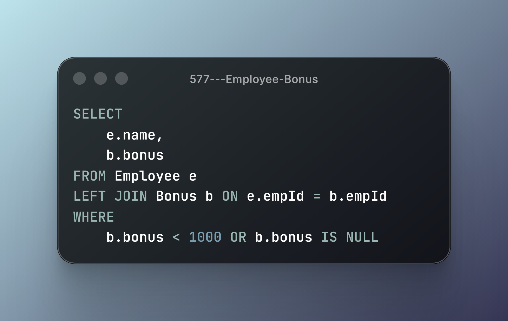
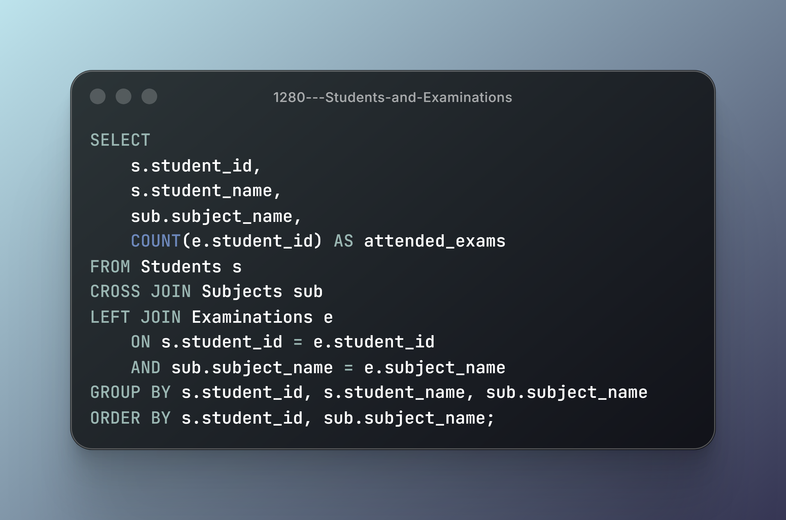
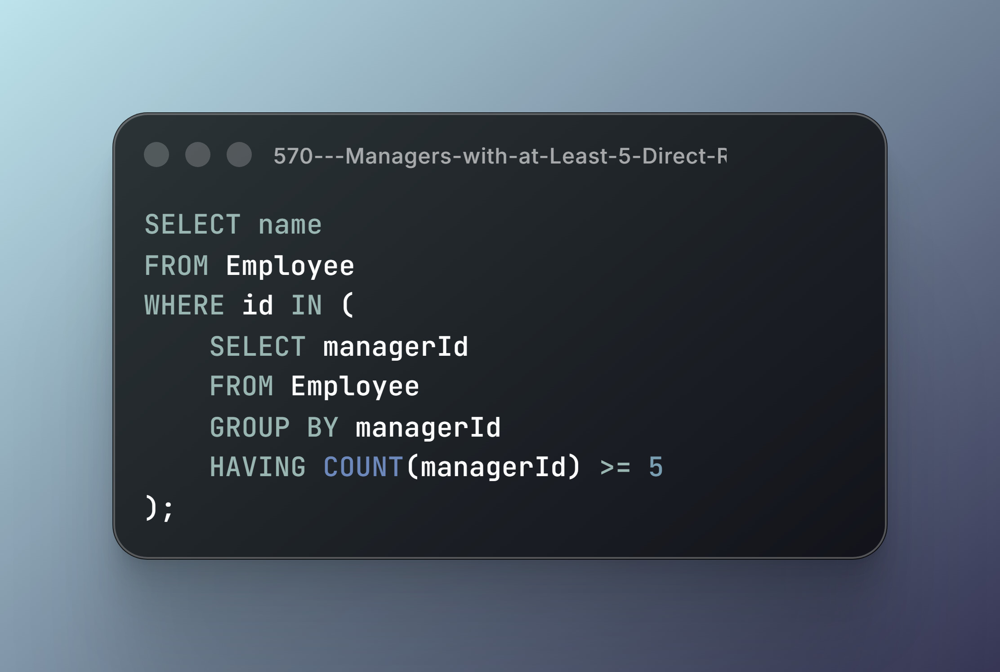
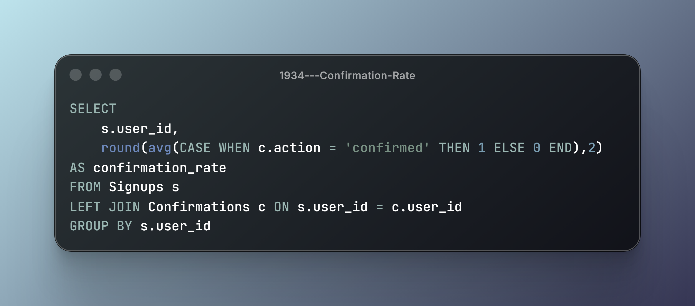

---

## Module 2: Basic Joins

**9 Problems | Relational Data Retrieval, Join Semantics & Cardinality**

Moving beyond isolated tables requires understanding how relational data connects, how unmatched records are preserved, and how multiple relations influence the resulting dataset.

This module explores fundamental JOIN operations through practical scenarios, focusing on relational matching, row preservation, self-referencing relationships, Cartesian products, and conditional aggregation.

### Technical Breakdown & Solutions

### 1. #1378 — Replace Employee ID With The Unique Identifier

- **Core Mechanics:** `LEFT JOIN` & Optional Relationships.
- **Engineering Insight:** A LEFT JOIN preserves every row from the left relation, even when no corresponding record exists on the right. Unmatched right-side attributes are represented as NULL.
- **Key Consideration:** Choosing INNER JOIN instead would eliminate employees without a matching unique identifier.

---

### 2. #1068 — Product Sales Analysis I

- **Core Mechanics:** `INNER JOIN` & Relational Matching.
- **Engineering Insight:** Transactional records can be enriched with reference data through shared relational keys. INNER JOIN returns only records satisfying the specified matching condition.
- **Key Consideration:** The join condition defines which product records can contribute to the resulting dataset.

---

### 3. #1581 — Customer Who Visited but Did Not Make Any Transactions

- **Core Mechanics:** Anti-Join & NULL Filtering.
- **Engineering Insight:** LEFT JOIN combined with an IS NULL condition identifies records without corresponding matches. This pattern is useful for detecting missing activity and unmatched relationships.
- **Key Consideration:** NOT EXISTS provides another way to express anti-join logic.

---

### 4. #197 — Rising Temperature

- **Core Mechanics:** Self JOIN & Temporal Comparison.
- **Engineering Insight:** A relation can be joined against itself to compare records across different points in time. Matching observations by calendar date allows consecutive-day comparisons without requiring a separate historical relation.
- **Key Consideration:** Consecutive dates and consecutive rows are not necessarily the same thing.

---

### 5. #1661 — Average Time of Process per Machine

- **Core Mechanics:** Self JOIN & Event Pairing.
- **Engineering Insight:** Start and end events can be stored as separate records within the same relation. A self-join pairs events using machine and process identifiers, enabling duration calculations and subsequent aggregation.
- **Key Consideration:** Correct event pairing is essential. Matching unrelated start and end events would produce incorrect durations.

---

### 6. #577 — Employee Bonus

- **Core Mechanics:** LEFT JOIN & Optional Data.
- **Engineering Insight:** When optional information must not eliminate primary records, LEFT JOIN preserves the original employee population while allowing missing bonus information to remain NULL.
- **Key Consideration:** Filtering right-side attributes in the WHERE clause can change outer-join semantics.

---

### 7. #1280 — Students and Examinations

- **Core Mechanics:** CROSS JOIN & Cartesian Products.
- **Engineering Insight:** CROSS JOIN generates every possible combination of the participating relations. Combining this result with LEFT JOIN allows reports to represent combinations with zero matching examination records.
- **Key Consideration:** Cartesian product cardinality grows multiplicatively with the sizes of the input relations.

---

### 8. #570 — Managers with at Least 5 Direct Reports

- **Core Mechanics:** Self JOIN & Relational Aggregation.
- **Engineering Insight:** Hierarchical relationships can be represented within a single relation. Joining employee records against their manager references enables the identification and aggregation of direct reports.
- **Key Consideration:** Understand the relationship between the employee and manager keys before applying aggregation.

---

### 9. #1934 — Confirmation Rate

- **Core Mechanics:** LEFT JOIN & Conditional Aggregation.
- **Engineering Insight:** User records and confirmation events are maintained in separate relations. LEFT JOIN preserves users without confirmation activity, while conditional aggregation calculates rates from available event data.
- **Key Consideration:** NULL handling, zero activity, and division behavior must be considered when calculating ratios.

---

## Module Takeaways

A JOIN is not merely a mechanism for combining tables.

It determines how relational information is matched, which records survive, and how the resulting dataset should be interpreted.

This module reinforces four fundamental concepts:

1. **Row Preservation:** Understanding INNER and OUTER JOIN semantics.
2. **Missing Relationships:** Identifying unmatched records through anti-join patterns.
3. **Self-Referencing Relations:** Exploring hierarchical and temporal relationships.
4. **Join Cardinality:** Understanding how relational combinations affect result-set size.

### PostgreSQL Documentation

- [7.2 — Table Expressions](https://www.postgresql.org/docs/current/queries-table-expressions.html)
- [14.3 — Controlling the Planner with Explicit JOIN Clauses](https://www.postgresql.org/docs/current/explicit-joins.html)
- [14.1 — Using EXPLAIN](https://www.postgresql.org/docs/current/using-explain.html)

### Documentation Format

Solutions are presented as code screenshots to maintain a consistent visual format across the learning series. Technical notes focus on SQL semantics and relevant PostgreSQL concepts.

---

## Module Status

- [x] Basic Select (5/5)
- [x] Basic Joins (9/9)
- [ ] Basic Aggregate Functions (0/8)
- [ ] Sorting and Grouping (0/7)
- [ ] Advanced Select and Joins (0/7)
- [ ] Subqueries (0/7)
- [ ] Advanced String Functions / Regex / Clause (0/7)