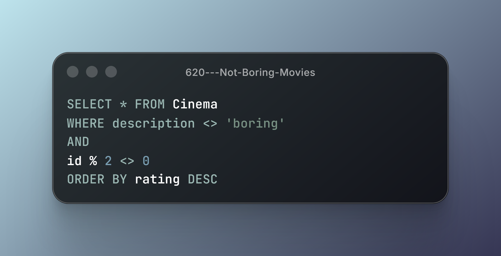
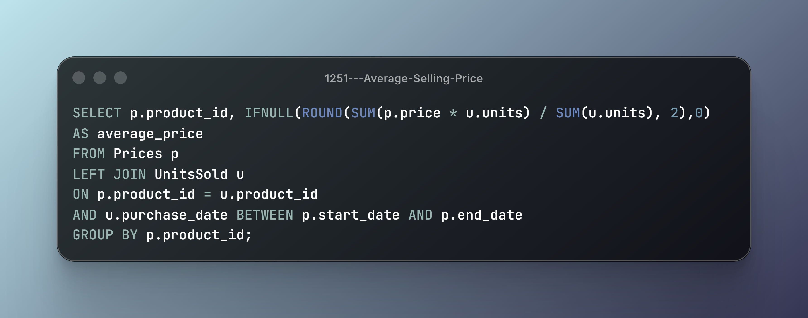
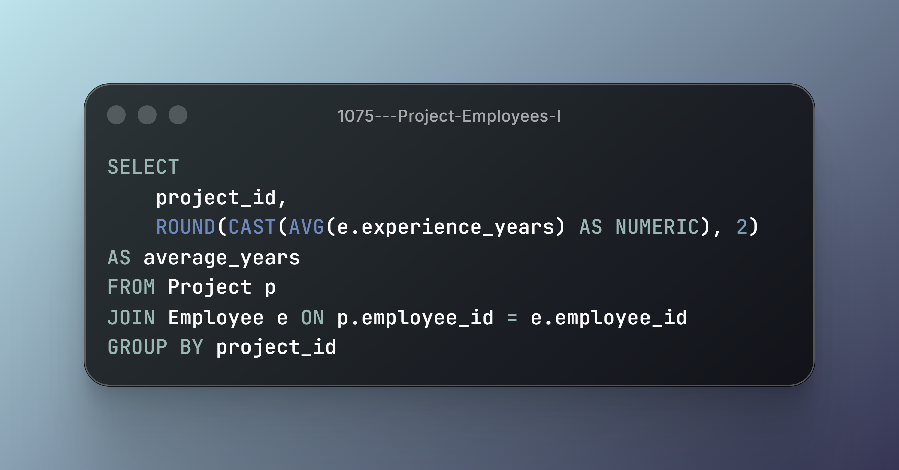
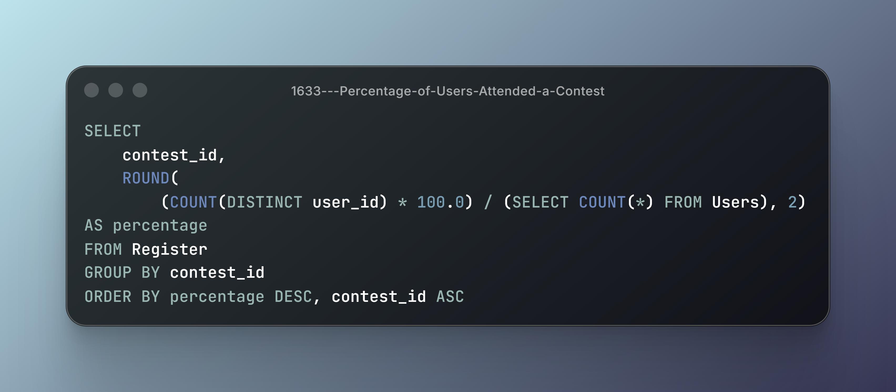
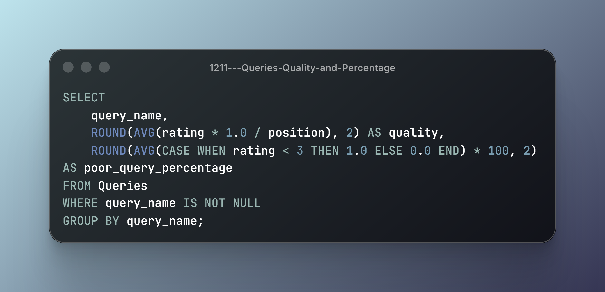
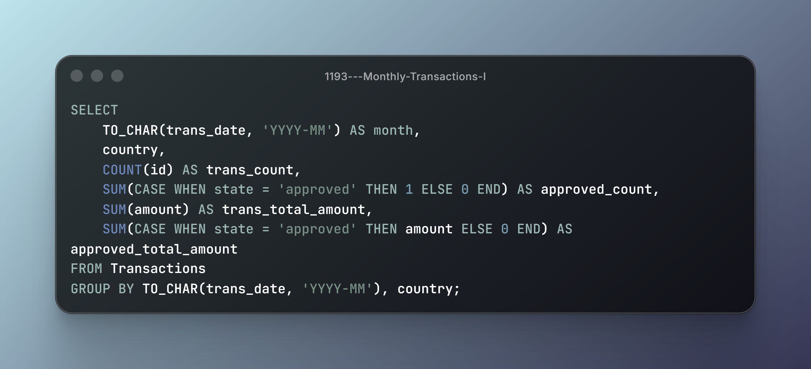
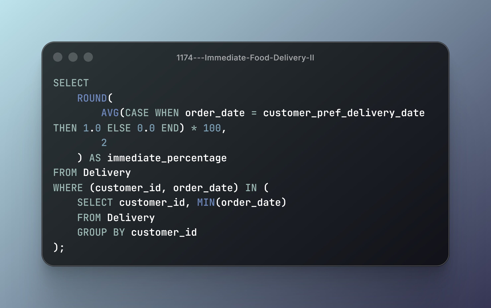
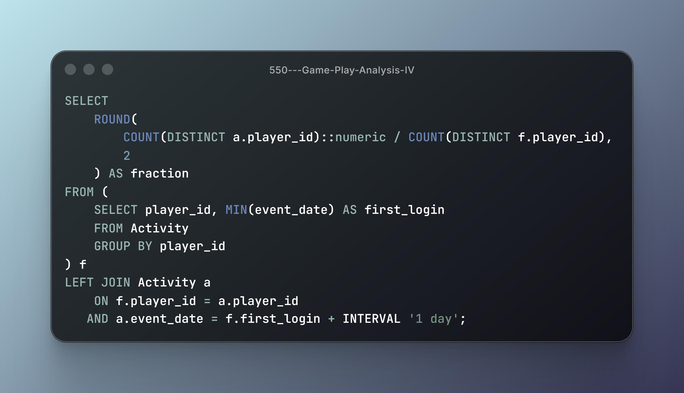

## Module 3: Basic Aggregate Functions

**8 Problems | Aggregate Functions, Numerical Calculations & Reporting-Oriented Queries**

Working with aggregated data requires understanding how individual records are transformed into summarized results, how numerical calculations are performed, and how conditions influence the resulting dataset.

This module explores SQL operations through practical scenarios, focusing on aggregate functions, conditional calculations, percentages, ratios, date-based analysis, filtering, and sorting.

### Technical Breakdown & Solutions

### 1. #620 — Not Boring Movies

- **Core Mechanics:** Filtering, Modulo Operator & `ORDER BY`.
- **Engineering Insight:** Filtering conditions can be combined to select records based on multiple criteria. The modulo operator allows identifying odd or even identifiers, while ORDER BY controls the ordering of the resulting records.
- **Key Consideration:** Filtering determines which records qualify for the result, whereas sorting determines their presentation order.

---

### 2. #1251 — Average Selling Price

- **Core Mechanics:** `LEFT JOIN`, Weighted Average & `ROUND()`.
- **Engineering Insight:** Calculating an average selling price requires accounting for both the price and the quantity sold. A weighted average reflects the contribution of each transaction group rather than treating every price as equally representative.
- **Key Consideration:** A simple arithmetic average and a weighted average do not necessarily produce the same result.

---

### 3. #1075 — Project Employees I

- **Core Mechanics:** `AVG()` & `GROUP BY`.
- **Engineering Insight:** Aggregate functions summarize numerical attributes across related records. Grouping project assignments allows average employee experience to be calculated independently for each project.
- **Key Consideration:** The grouping key determines the scope of each aggregate result.

---

### 4. #1633 — Percentage of Users Attended a Contest

- **Core Mechanics:** `COUNT()`, `GROUP BY`, Percentage Calculation & `ROUND()`.
- **Engineering Insight:** Percentage calculations transform raw counts into relative measurements. The result depends on correctly identifying the numerator and denominator before applying division and rounding.
- **Key Consideration:** The denominator must represent the correct population. Decimal precision and division behavior can also affect the final percentage.

---

### 5. #1211 — Queries Quality and Percentage

- **Core Mechanics:** Conditional Aggregation, `AVG()` & `ROUND()`.
- **Engineering Insight:** Aggregate expressions can calculate multiple metrics from individual records. Conditional expressions allow specific records to contribute differently to each calculation.
- **Key Consideration:** The conditions defining each metric must be accurate. NULL handling and the treatment of records outside those conditions can influence aggregate results.

---

### 6. #1193 — Monthly Transactions I

- **Core Mechanics:** Conditional Aggregation, `GROUP BY` & Date-Based Grouping.
- **Engineering Insight:** Transaction records can be grouped by month and country while conditional aggregation separates transaction states into distinct numerical metrics.
- **Key Consideration:** Grouping dimensions and conditional calculations serve different purposes. Both must be defined correctly to produce meaningful reporting results.

---

### 7. #1174 — Immediate Food Delivery II

- **Core Mechanics:** First-Order Identification, Conditional Aggregation & Percentage Calculation.
- **Engineering Insight:** Identifying each customer's first order establishes the population for the calculation. Comparing the order date with the preferred delivery date then determines which first orders qualify as immediate.
- **Key Consideration:** The calculation must use each customer's first order rather than the entire order history.

---

### 8. #550 — Game Play Analysis IV

- **Core Mechanics:** First-Event Identification, Date Comparison & Ratio Calculation.
- **Engineering Insight:** Identifying each player's first login makes it possible to evaluate subsequent activity relative to that initial event. Comparing login dates allows the required next-day retention metric to be calculated.
- **Key Consideration:** The reference date must be the player's first login date. The eligible player population must also be defined correctly before calculating the ratio.

---

## Module Takeaways

Aggregate functions are fundamental SQL capabilities.

They provide the mechanisms needed to summarize records, calculate metrics, and transform relational data into meaningful results.

However, the dominant practical focus of this module was numerical and reporting-oriented query development. Repeated multiplication, division, decimal calculations, rounding, percentage generation, and ratio calculations shaped much of the problem-solving experience.

This module reinforces four fundamental concepts:

1. **Aggregate Fundamentals:** Understanding how aggregate functions summarize individual records and how grouping determines the scope of calculations.
2. **Numerical Calculations:** Working with averages, weighted averages, percentages, ratios, decimal values, and rounding.
3. **Conditional Aggregation:** Applying conditions to calculate specific metrics from grouped data.
4. **Data Interpretation:** Identifying the correct population, reference dates, and calculation boundaries before producing a result.

From a database engineering perspective, understanding aggregate operations is essential. However, the emphasis on advanced reporting-oriented calculations in this module also highlights a distinction between learning SQL fundamentals and specializing in analytical query development.

For my engineering direction, I want to build a solid understanding of these operations while keeping my deeper focus on database behavior, administration, performance, reliability, and system-level engineering.

### PostgreSQL Documentation

- [9.21 — Aggregate Functions](https://www.postgresql.org/docs/current/functions-aggregate.html)
- [4.2.7 — Aggregate Expressions](https://www.postgresql.org/docs/current/sql-expressions.html#SYNTAX-AGGREGATES)
- [7.2.4 — The GROUP BY and HAVING Clauses](https://www.postgresql.org/docs/current/queries-table-expressions.html#QUERIES-GROUP)
- [9.3 — Mathematical Functions and Operators](https://www.postgresql.org/docs/current/functions-math.html)

### Documentation Format

Solutions are presented as code screenshots to maintain a consistent visual format across the learning series. Technical notes focus on SQL semantics and relevant PostgreSQL concepts.

---

## Module Status

- [x] Basic Select (5/5)
- [x] Basic Joins (9/9)
- [x] Basic Aggregate Functions (8/8)
- [ ] Sorting and Grouping (0/7)
- [ ] Advanced Select and Joins (0/7)
- [ ] Subqueries (0/7)
- [ ] Advanced String Functions / Regex / Clause (0/7)
