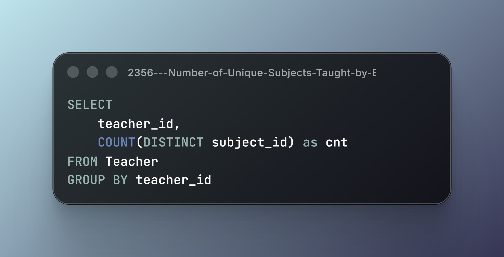
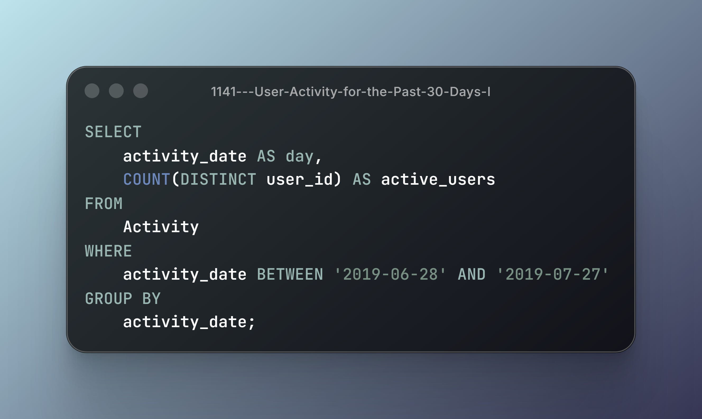
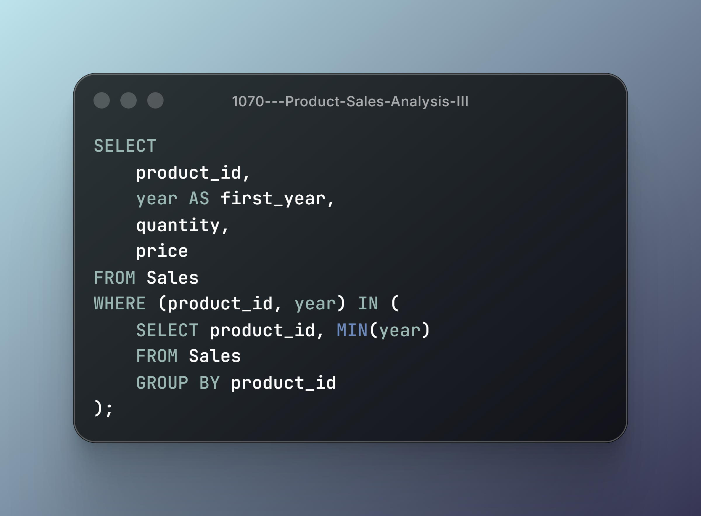
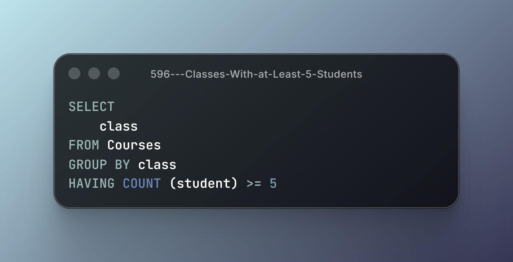
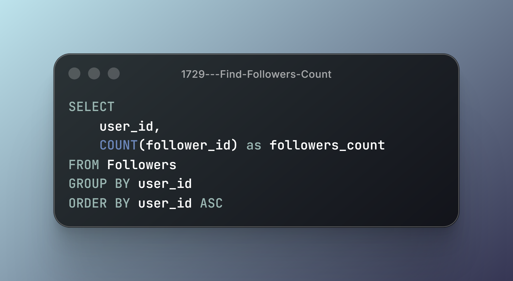
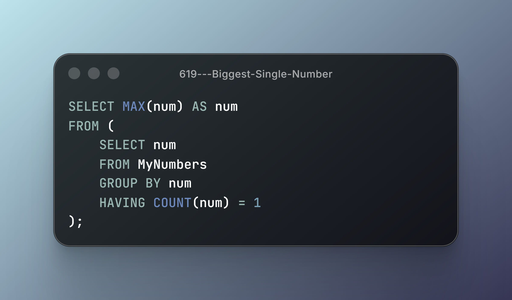
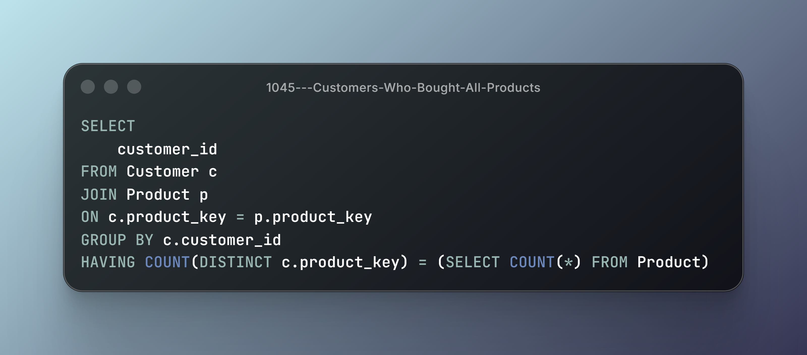

## Module 4: Sorting and Grouping

**7 Problems | GROUP BY, DISTINCT, HAVING, Subqueries & Result Ordering**

Working with grouped data requires more than applying aggregate functions. It involves defining the correct grouping dimensions, identifying distinct values, filtering aggregated results, and determining how individual records relate to grouped conditions.

This module explores SQL operations through practical scenarios, focusing on distinct counting, date-based filtering, first-occurrence identification, aggregate filtering, result ordering, and relational division.

### Technical Breakdown & Solutions

### 1. #2356 — Number of Unique Subjects Taught by Each Teacher

- **Core Mechanics:** `GROUP BY`, `COUNT(DISTINCT)`.
- **Engineering Insight:** Grouping records by teacher allows each teacher's teaching activity to be evaluated independently. `COUNT(DISTINCT)` calculates the number of unique subjects within each group.
- **Key Consideration:** Counting all records and counting distinct values represent different measurements. Duplicate subject assignments must not inflate the result.

---

### 2. #1141 — User Activity for the Past 30 Days I

- **Core Mechanics:** Date Filtering, `COUNT(DISTINCT)`, `GROUP BY`.
- **Engineering Insight:** Activity records can be filtered by a defined date interval and grouped by user to calculate daily activity. Distinct date counting prevents multiple activities on the same day from being counted as separate active days.
- **Key Consideration:** The date interval must follow the problem's specified reference date and boundaries. The unit being counted is active days, not total activity records.

---

### 3. #1070 — Product Sales Analysis III

- **Core Mechanics:** `MIN()`, Subqueries, Filtering by First Occurrence.
- **Engineering Insight:** Identifying the first year of sales for each product establishes a reference point for retrieving the corresponding sales records. A subquery can determine the minimum year independently for each product.
- **Key Consideration:** Identifying the first year and retrieving all sales from that year are separate logical requirements. Products may have multiple sales records in their first year.

---

### 4. #596 — Classes More Than 5 Students

- **Core Mechanics:** `GROUP BY`, `COUNT()`, `HAVING`.
- **Engineering Insight:** Grouping student records by class makes it possible to calculate the number of students in each class. `HAVING` filters the resulting groups according to aggregate conditions.
- **Key Consideration:** `WHERE` filters individual rows before grouping, whereas `HAVING` filters groups after aggregate calculations.

---

### 5. #1729 — Find Followers Count

- **Core Mechanics:** `GROUP BY`, `COUNT()`, `ORDER BY`.
- **Engineering Insight:** Grouping follower relationships by user allows the number of followers to be calculated independently for each user. The resulting records can then be ordered according to the required identifier.
- **Key Consideration:** The grouping key determines whose followers are counted. Result ordering is a separate operation and must follow the specified sorting requirement.

---

### 6. #619 — Biggest Single Number

- **Core Mechanics:** `GROUP BY`, `COUNT()`, `HAVING`, `MAX()`, Subqueries.
- **Engineering Insight:** Identifying numbers that occur exactly once requires grouping records by number and filtering groups based on their occurrence count. The maximum value can then be selected from the qualifying numbers.
- **Key Consideration:** The maximum value must be calculated only after identifying numbers that occur exactly once. If no number satisfies the condition, the expected result is `NULL`.

---

### 7. #1045 — Customers Who Bought All Products

- **Core Mechanics:** `GROUP BY`, `COUNT(DISTINCT)`, `HAVING`, Scalar Subqueries.
- **Engineering Insight:** Determining which customers purchased every available product requires comparing each customer's distinct product count with the total number of products. This represents a relational division problem: identifying entities associated with every member of a required set.
- **Key Consideration:** The comparison must use distinct products and the complete product population. Duplicate purchase records must not inflate a customer's product count.

---

## Module Takeaways

Grouping and sorting are fundamental SQL operations, but their practical use requires understanding how records are organized, filtered, and evaluated.

This module moves beyond basic aggregation and focuses on the relationship between grouping dimensions, distinct values, aggregate conditions, and subquery-based comparisons.

The exercises reinforce five fundamental concepts:

1. **Grouping and Distinct Counting:** Using `GROUP BY` and `COUNT(DISTINCT)` to summarize records without counting duplicate values.
2. **Aggregate Filtering:** Understanding how `HAVING` filters groups based on calculated aggregate results.
3. **Date-Based Analysis:** Applying date boundaries to identify records within a defined time interval.
4. **Subqueries and First Occurrences:** Using subqueries to identify reference values such as the earliest year associated with an entity.
5. **Relational Division:** Comparing grouped results against a complete reference set to identify entities satisfying all required conditions.

From a database engineering perspective, these operations are important building blocks for understanding how relational data is grouped and evaluated. They also provide a foundation for more complex analytical queries.

The emphasis remains on understanding SQL semantics, not simply memorizing query patterns.

### PostgreSQL Documentation

- [7.2.3 — The GROUP BY and HAVING Clauses](https://www.postgresql.org/docs/18/queries-table-expressions.html#QUERIES-GROUP)
- [9.21 — Aggregate Functions](https://www.postgresql.org/docs/18/functions-aggregate.html)
- [4.2.7 — Aggregate Expressions](https://www.postgresql.org/docs/18/sql-expressions.html#SYNTAX-AGGREGATES)
- [9.18 — Conditional Expressions](https://www.postgresql.org/docs/18/functions-conditional.html)
- [9.25 — Row and Array Comparisons](https://www.postgresql.org/docs/18/functions-comparisons.html)
- [9.9 — Date/Time Functions and Operators](https://www.postgresql.org/docs/18/functions-datetime.html)
- [7.5 — Sorting Rows (`ORDER BY`)](https://www.postgresql.org/docs/18/queries-order.html)

### Documentation Format

Solutions are presented as code screenshots to maintain a consistent visual format across the learning series. Technical notes focus on SQL semantics and relevant PostgreSQL concepts.

---

## Module Status

- [x] Basic Select (5/5)
- [x] Basic Joins (9/9)
- [x] Basic Aggregate Functions (8/8)
- [x] Sorting and Grouping (7/7)
- [ ] Advanced Select and Joins (0/7)
- [ ] Subqueries (0/7)
- [ ] Advanced String Functions / Regex / Clause (0/7)

**Overall Progress: 29/50 Problems Completed**
