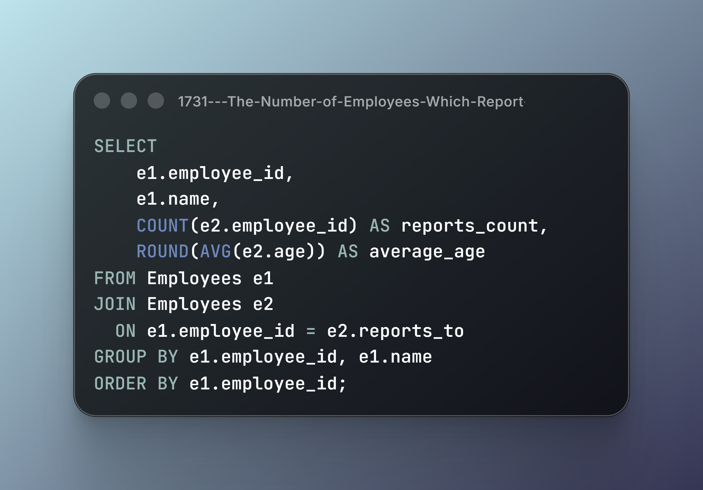
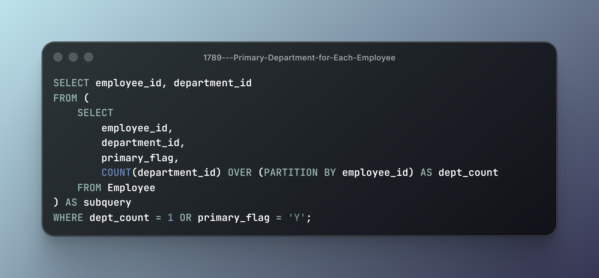
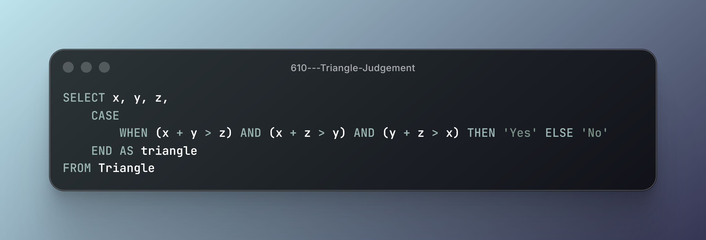
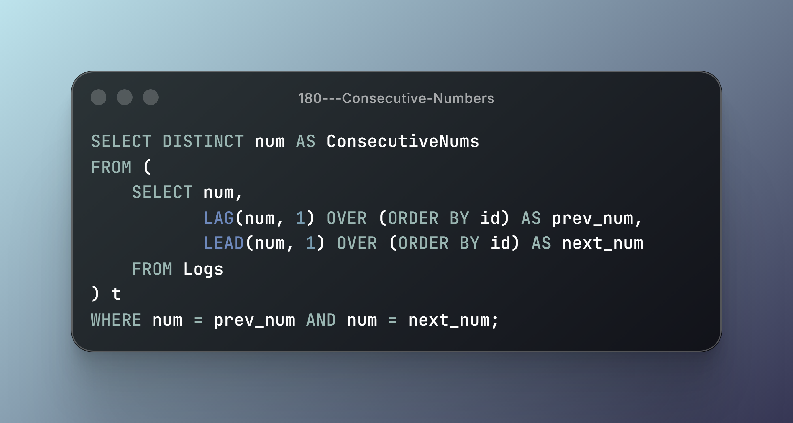
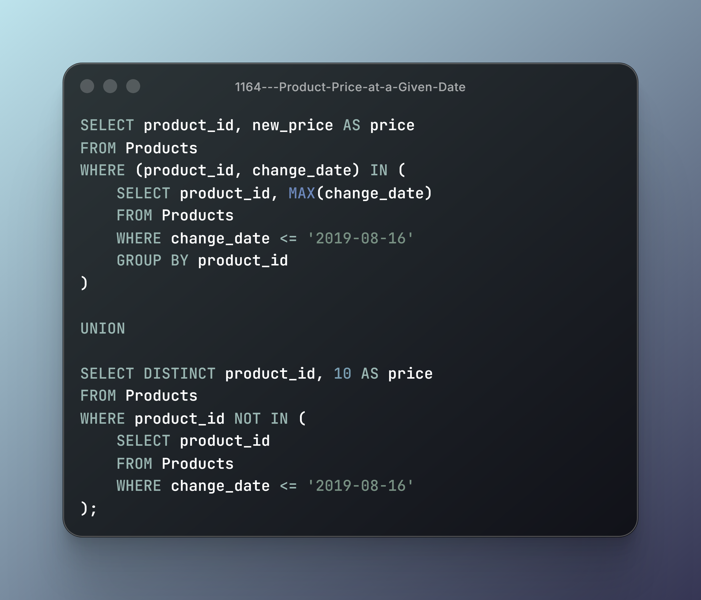
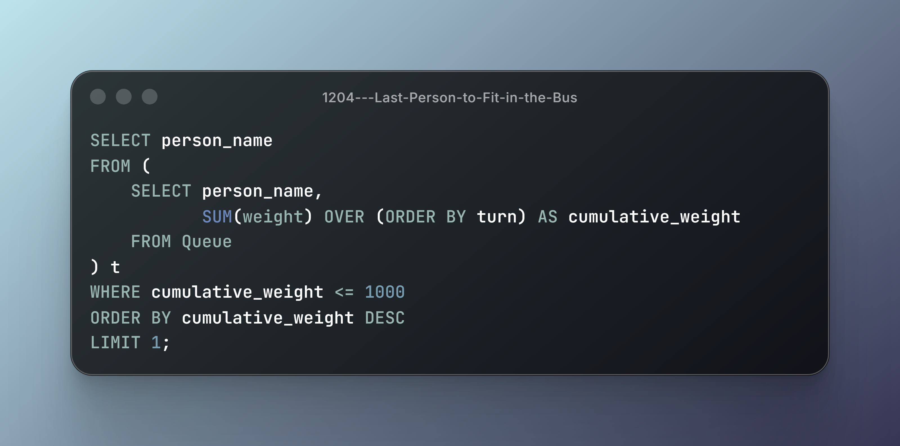
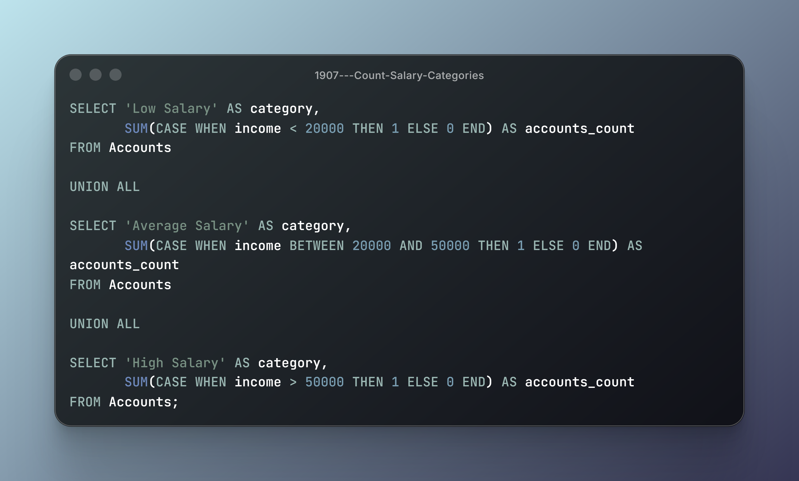

## Module 5: Advanced Select and Joins

**7 Problems | Self-Joins, Conditional Logic, Window Functions & Cumulative Calculations**

Advanced SQL problem-solving requires understanding relationships between records, evaluating conditions across multiple rows, and performing calculations based on ordered data.

This module explores SQL operations through practical scenarios, focusing on hierarchical relationships, conditional filtering, consecutive records, historical data retrieval, cumulative calculations, and conditional aggregation.

### Technical Breakdown & Solutions

### 1. #1731 — The Number of Employees Which Report to Each Employee

- **Core Mechanics:** Self-Joins, `COUNT()`, `AVG()`, `GROUP BY`, `ROUND()`.
- **Engineering Insight:** Self-joining the employee table makes it possible to connect employees with their respective managers. Grouping these relationships by manager allows the number of direct reports and their average age to be calculated.
- **Key Consideration:** Table aliases establish the different logical roles of the same table. The join condition must correctly associate each employee with their manager.

---

### 2. #1789 — Primary Department for Each Employee

- **Core Mechanics:** Conditional Filtering, `WHERE`, `OR`, Multiple-Row Relationships.
- **Engineering Insight:** Employees may belong to multiple departments, but the required result identifies one primary department for each employee. The query must account for both explicitly designated primary departments and employees associated with only one department.
- **Key Consideration:** Filtering only for records marked as primary would exclude employees whose single department is implicitly their primary department.

---

### 3. #610 — Triangle Judgement

- **Core Mechanics:** `CASE`, Conditional Expressions, Arithmetic Operations, Boolean Conditions.
- **Engineering Insight:** Determining whether three values can represent the sides of a valid triangle requires evaluating the triangle inequality. The sum of any two sides must be strictly greater than the third side.
- **Key Consideration:** All three inequalities must hold. Checking only one combination is insufficient to establish a valid triangle.

---

### 4. #180 — Consecutive Numbers

- **Core Mechanics:** Self-Joins, Row Relationships, Consecutive Identifiers, `DISTINCT`.
- **Engineering Insight:** Identifying a number that appears in at least three consecutive records requires comparing relationships between multiple rows rather than evaluating individual records independently.
- **Key Consideration:** The query must establish the required consecutive-row relationship. Consecutive identifiers should be interpreted according to the ordering and assumptions defined by the problem.

---

### 5. #1164 — Product Price at a Given Date

- **Core Mechanics:** Date Filtering, Historical Data, Conditional Logic, Aggregation, Default Values.
- **Engineering Insight:** Retrieving a product's price at a specific date requires identifying its latest price change on or before the target date. Products without a qualifying price change must use the specified default price.
- **Key Consideration:** The date boundary is essential. A price change occurring after the target date must not affect the historical price being retrieved.

---

### 6. #1204 — Last Person to Fit in the Bus

- **Core Mechanics:** Window Functions, `SUM() OVER`, Cumulative Calculations, `ORDER BY`.
- **Engineering Insight:** Calculating cumulative weight in boarding order makes it possible to determine which person is the last to board without exceeding the bus capacity.
- **Key Consideration:** The cumulative calculation depends on a defined ordering. The total weight alone cannot determine the last eligible person in a sequential process.

---

### 7. #1907 — Count Salary Categories

- **Core Mechanics:** Conditional Aggregation, `CASE`, `COUNT()`, `SUM()`.
- **Engineering Insight:** Classifying accounts into salary categories and counting the records in each category requires combining conditional logic with aggregation.
- **Key Consideration:** All required categories must appear in the result, including categories with zero matching accounts. Returning only categories present in the source data does not satisfy the complete output requirement.

---

## Module Takeaways

Advanced SQL operations require understanding how individual records relate to one another and how conditions can be evaluated across multiple rows.

This module moves beyond basic joins and aggregation, focusing on relationships between records, historical values, sequential calculations, and conditional result construction.

The exercises reinforce five fundamental concepts:

1. **Self-Joins and Row Relationships:** Using the same table in different logical roles to represent hierarchical relationships and compare records.
2. **Conditional Logic:** Applying conditions through `CASE` expressions and filtering to represent specific business rules.
3. **Consecutive Records:** Identifying relationships across multiple rows rather than evaluating records independently.
4. **Historical and Cumulative Analysis:** Retrieving values relative to a reference date and calculating running totals over an ordered sequence.
5. **Conditional Aggregation:** Combining classification logic with aggregate functions to produce category-based summaries.

From a database engineering perspective, these operations are important building blocks for expressing more complex relational requirements. They also introduce concepts that are useful when working with analytical queries and structured data transformations.

The emphasis remains on understanding SQL semantics and relationships between records, not simply memorizing query patterns.

### PostgreSQL Documentation

- [7.2 — Table Expressions](https://www.postgresql.org/docs/18/queries-table-expressions.html)
- [4.2.14 — Expression Evaluation Rules](https://www.postgresql.org/docs/18/sql-expressions.html#SYNTAX-EXPRESS-EVAL)
- [9.18 — Conditional Expressions](https://www.postgresql.org/docs/18/functions-conditional.html)
- [9.21 — Aggregate Functions](https://www.postgresql.org/docs/18/functions-aggregate.html)
- [3.5 — Window Functions](https://www.postgresql.org/docs/18/tutorial-window.html)
- [9.9 — Date/Time Functions and Operators](https://www.postgresql.org/docs/18/functions-datetime.html)
- [7.5 — Sorting Rows (`ORDER BY`)](https://www.postgresql.org/docs/18/queries-order.html)

### Documentation Format

Solutions are presented as code screenshots to maintain a consistent visual format across the learning series. Technical notes focus on SQL semantics and relevant PostgreSQL concepts.

---

## Module Status

- [x] Basic Select (5/5)
- [x] Basic Joins (9/9)
- [x] Basic Aggregate Functions (8/8)
- [x] Sorting and Grouping (7/7)
- [x] Advanced Select and Joins (7/7)
- [ ] Subqueries (0/7)
- [ ] Advanced String Functions / Regex / Clause (0/7)

**Overall Progress: 36/50 Problems Completed**
