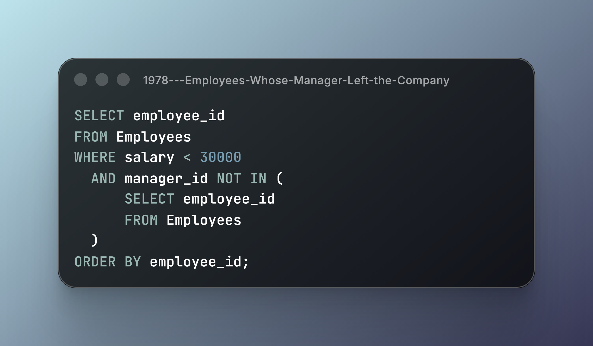
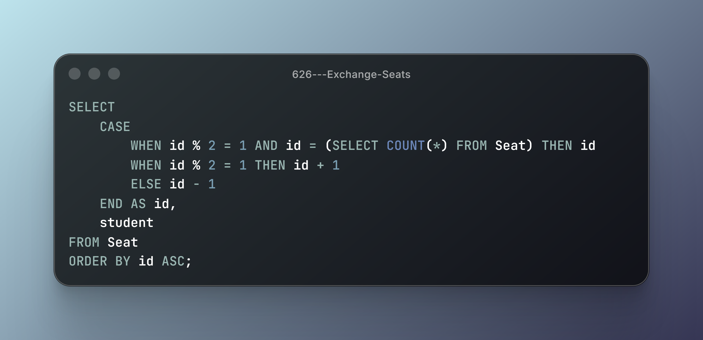
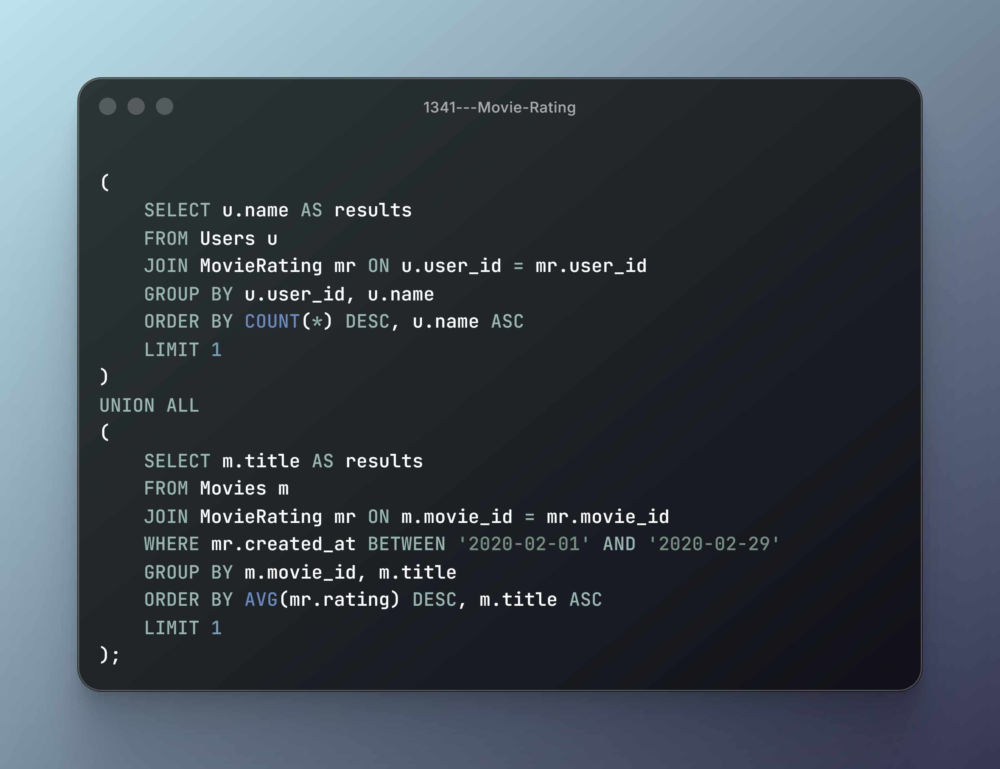
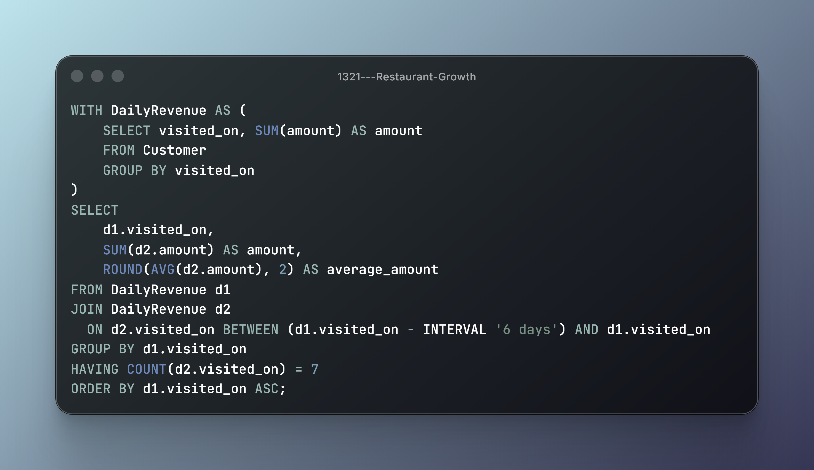
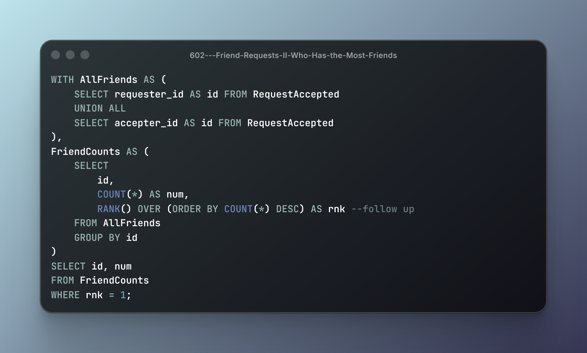
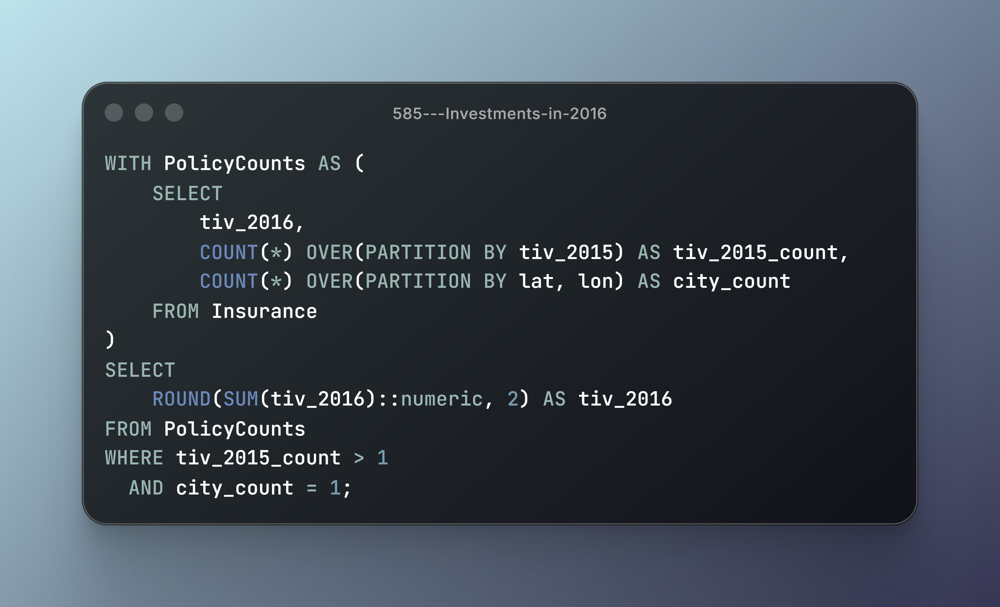
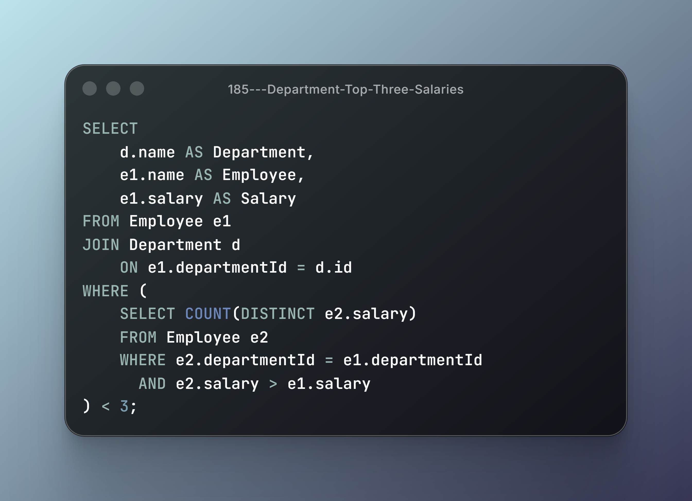

## Module 6: Subqueries

**7 Problems | Nested Queries, Relational Conditions, Aggregation & Ranking**

Subqueries allow a query to use the result of another query as an input to its own logic. They make it possible to express conditions, comparisons, and calculations that depend on data retrieved from the same or related tables.

This module explores SQL problem-solving through nested query logic, multi-level aggregation, relational comparisons, conditional filtering, and ranking requirements. The exercises also demonstrate how complex result requirements can involve combining subqueries with other SQL operations.

### Technical Breakdown & Solutions

### 1. #1978 — Employees Whose Manager Left the Company

- **Core Mechanics:** Subqueries, `NOT IN`, `NULL` Handling, Conditional Filtering.
- **Engineering Insight:** Identifying employees whose managers are no longer present in the company requires checking relationships between employee records and determining whether the referenced manager still exists.
- **Key Consideration:** Missing references and `NULL` values must be handled carefully. In particular, `NOT IN` can produce unexpected results when its subquery returns `NULL`.

---

### 2. #626 — Exchange Seats

- **Core Mechanics:** Conditional Logic, `CASE`, Row Identifiers, Arithmetic Operations.
- **Engineering Insight:** Exchanging the positions of adjacent students requires transforming the relationship between sequential seat identifiers while preserving the final position when the number of students is odd.
- **Key Consideration:** The transformation must account for both even and odd identifiers. The final student must retain their original position when no adjacent student exists.

---

### 3. #1341 — Movie Rating

- **Core Mechanics:** Subqueries, Aggregation, `COUNT()`, `AVG()`, Grouping, Sorting, Tie-Breaking.
- **Engineering Insight:** This problem requires identifying two different results: the user who has submitted the most movie ratings and the movie with the highest average rating during a specified month. Each result has its own aggregation and ordering requirements.
- **Key Consideration:** The two selection criteria are independent. Tie-breaking rules must also be respected: alphabetical ordering is required when multiple users or movies share the relevant result.

---

### 4. #1321 — Restaurant Growth

- **Core Mechanics:** Date Filtering, `SUM()`, `AVG()`, Rolling Aggregation, Window Functions, `ROUND()`.
- **Engineering Insight:** Calculating a seven-day moving average of customer spending requires aggregating daily revenue over a defined time interval. The result represents a rolling calculation rather than an independent daily total.
- **Key Consideration:** The seven-day window must be applied consistently, including its boundary dates. The output should contain only dates for which the required seven-day period is available, and the average must be rounded to the specified precision.

---

### 5. #602 — Friend Requests II: Who Has the Most Friends

- **Core Mechanics:** Subqueries, `UNION ALL`, Aggregation, `COUNT()`, Grouping, Maximum-Value Selection.
- **Engineering Insight:** A friendship relationship can be represented from either participant's perspective. Determining who has the most friends therefore requires accounting for both request senders and request accepters before calculating the total number of connections per user.
- **Key Consideration:** Counting only one side of the relationship produces incomplete results. Both participant roles must contribute to the final count.

---

### 6. #585 — Investments in 2016

- **Core Mechanics:** Subqueries, `SUM()`, `COUNT()`, `GROUP BY`, `HAVING`, Multi-Condition Filtering.
- **Engineering Insight:** Calculating the required investment total involves identifying policyholders who share the same 2015 investment value with at least one other policyholder, while also requiring their geographical location to be unique.
- **Key Consideration:** The two conditions represent different grouping requirements. Sharing an investment value and having a unique location must be evaluated independently before the qualifying investments are summed.

---

### 7. #185 — Department Top Three Salaries

- **Core Mechanics:** Subqueries, Ranking, Window Functions, `DENSE_RANK()`, Partitioning, Conditional Filtering.
- **Engineering Insight:** Finding the top three salary levels in each department requires evaluating salary positions within separate departmental groups. Employees sharing a qualifying salary level must all be included in the result.
- **Key Consideration:** The requirement concerns the top three distinct salary levels, not simply the first three employee records. Ranking semantics and tie handling therefore determine whether the result is correct.

---

## Module Takeaways

Subqueries provide a way to express query logic that depends on the results of other queries. Their value is not limited to nesting one `SELECT` statement inside another; they allow complex relational requirements to be broken into smaller logical operations.

This module reinforces five important concepts:

1. **Nested Query Logic:** Using the result of one query as an input to another query for filtering, comparison, and calculation.
2. **Relational Conditions:** Evaluating whether related records exist, whether references are missing, and how multiple records contribute to a result.
3. **Aggregation and Grouping:** Applying aggregate functions to derive totals, averages, counts, and qualifying groups.
4. **Conditional and Multi-Level Filtering:** Combining independent conditions and applying them at the appropriate level of query logic.
5. **Ranking and Tie Handling:** Distinguishing between ranking individual records and identifying the highest distinct values within groups.

From a database engineering perspective, understanding subqueries means understanding how query results can participate in larger relational expressions. It also requires attention to `NULL` semantics, grouping boundaries, comparison rules, and the exact meaning of ranking requirements.

A query can return plausible results while still violating one of these conditions. Correctness depends on expressing the complete requirement—not merely producing a result that looks reasonable.

### PostgreSQL Documentation

- [4.2.11 — Scalar Subqueries](https://www.postgresql.org/docs/18/sql-expressions.html#SQL-SYNTAX-SCALAR-SUBQUERIES)
- [9.24 — Subquery Expressions](https://www.postgresql.org/docs/18/functions-subquery.html)
- [7.2 — Table Expressions](https://www.postgresql.org/docs/18/queries-table-expressions.html)
- [9.21 — Aggregate Functions](https://www.postgresql.org/docs/18/functions-aggregate.html)
- [9.22 — Window Functions](https://www.postgresql.org/docs/18/functions-window.html)
- [9.18 — Conditional Expressions](https://www.postgresql.org/docs/18/functions-conditional.html)
- [9.9 — Date/Time Functions and Operators](https://www.postgresql.org/docs/18/functions-datetime.html)

### Documentation Format

Solutions are presented as code screenshots to maintain a consistent visual format across the learning series. Technical notes focus on SQL semantics and relevant PostgreSQL concepts.

---

## Module Status

- [x] Basic Select (5/5)
- [x] Basic Joins (9/9)
- [x] Basic Aggregate Functions (8/8)
- [x] Sorting and Grouping (7/7)
- [x] Advanced Select and Joins (7/7)
- [x] Subqueries (7/7)
- [ ] Advanced String Functions / Regex / Clause (0/7)

**Overall Progress: 43/50 Problems Completed**
