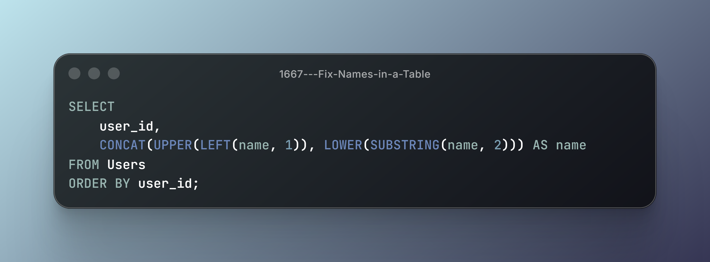
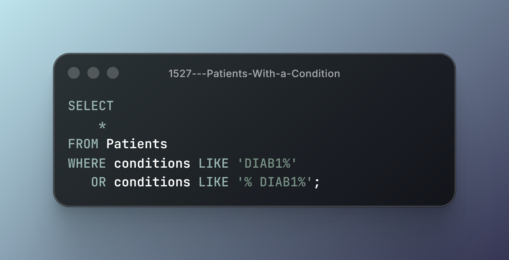
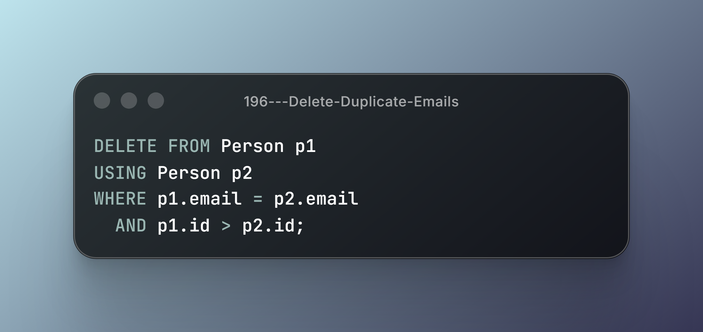
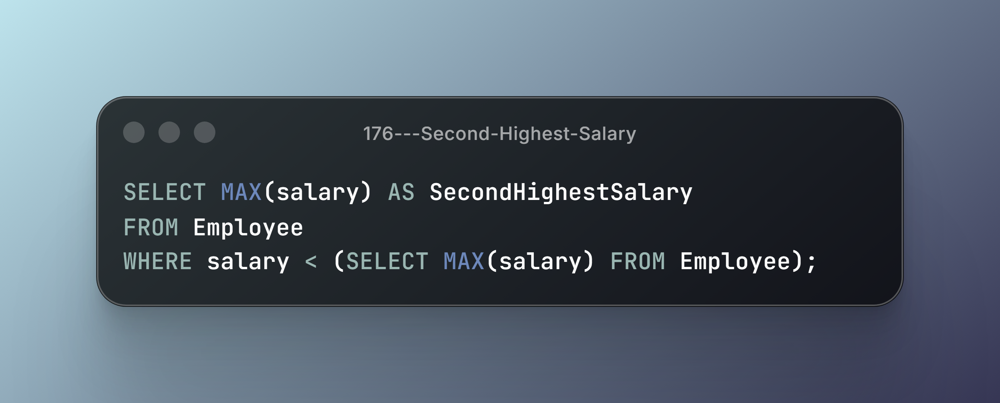
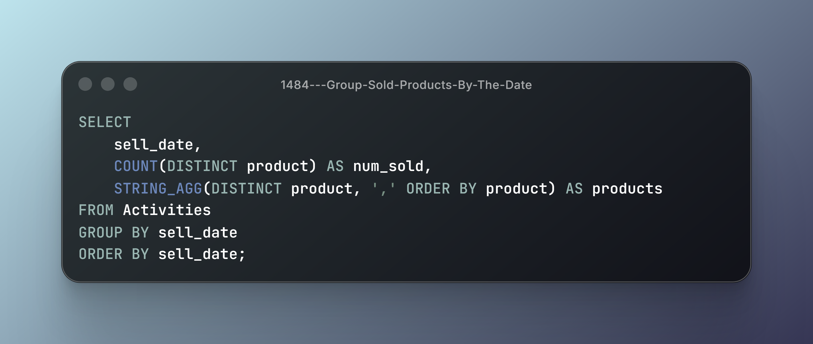
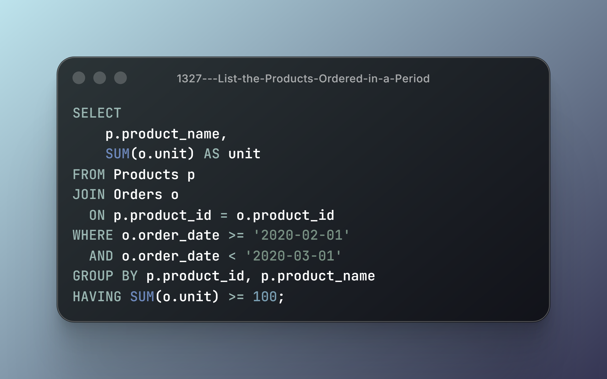
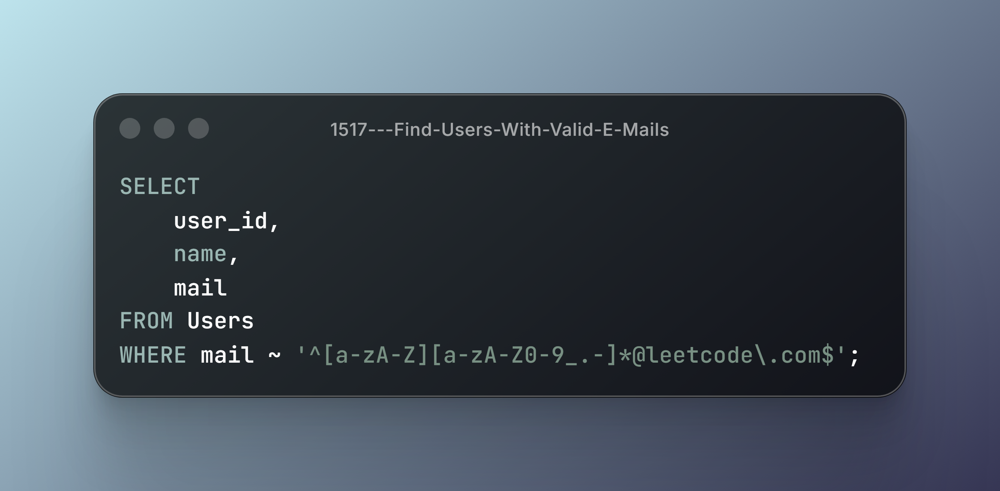

## Module 7: Advanced String Functions / Regex / Clause

**7 Problems | String Manipulation, Pattern Matching, Regular Expressions & Data Transformation**

Working with structured data often requires more than filtering records or calculating aggregate values. String manipulation and pattern matching make it possible to inspect, validate, transform, and extract information from textual data.

This module explores SQL operations through practical scenarios involving string functions, character manipulation, regular expressions, pattern matching, conditional extraction, and data validation.

The exercises focus on understanding how textual values can be processed through SQL expressions while preserving the requirements of the expected result.

### Technical Breakdown & Solutions

### 1. #1667 — Fix Names in a Table

- **Core Mechanics:** String Functions, `UPPER()`, `LOWER()`, `CONCAT()`, String Manipulation.
- **Engineering Insight:** Standardizing names requires transforming textual values into a consistent format. The first character must be uppercase while the remaining characters must be lowercase.
- **Key Consideration:** String transformation must preserve the original name while applying the required capitalization rules consistently.

---

### 2. #1527 — Patients With a Condition

- **Core Mechanics:** Pattern Matching, `LIKE`, String Filtering, Conditional Expressions.
- **Engineering Insight:** Identifying records containing a specific condition code requires examining structured information stored within a textual column.
- **Key Consideration:** Matching the required condition must respect the boundaries of the code. A partial substring match can incorrectly identify records containing a similar but different condition code.

---

### 3. #196 — Delete Duplicate Emails

- **Core Mechanics:** Duplicate Detection, Subqueries, Self-Joins, `DELETE`, Record Identification.
- **Engineering Insight:** Removing duplicate records requires identifying which records represent repeated values and determining which record should be preserved.
- **Key Consideration:** The operation must retain the record with the smallest identifier for each email address while removing the remaining duplicates.

---

### 4. #176 — Second Highest Salary

- **Core Mechanics:** Subqueries, `DISTINCT`, Aggregation, `MAX()`, `NULL` Handling.
- **Engineering Insight:** Identifying the second-highest distinct salary requires separating unique salary values from individual employee records before determining the required result.
- **Key Consideration:** Duplicate salary values must not be treated as different ranking positions. The query must also return `NULL` when a second distinct salary does not exist.

---

### 5. #1484 — Group Sold Products By The Date

- **Core Mechanics:** Aggregation, `GROUP BY`, `COUNT(DISTINCT)`, `STRING_AGG()`, Sorting.
- **Engineering Insight:** Grouping products by their sale date requires producing both a distinct product count and a concatenated list of product names for each date.
- **Key Consideration:** Duplicate product names must not inflate the distinct count. The concatenated product list must also follow the required ordering.

---

### 6. #1327 — List the Products Ordered in a Period

- **Core Mechanics:** Date Filtering, `GROUP BY`, `SUM()`, `HAVING`, Conditional Aggregation.
- **Engineering Insight:** Identifying products with sufficient order volume during a specified period requires filtering orders by date, grouping them by product, and evaluating their total quantities.
- **Key Consideration:** The date boundaries and minimum quantity requirement must both be applied correctly. Filtering individual orders is not equivalent to filtering the aggregated quantity over the entire period.

---

### 7. #1517 — Find Users With Valid E-Mails

- **Core Mechanics:** Regular Expressions, Pattern Matching, `LIKE`, String Validation.
- **Engineering Insight:** Validating email addresses through SQL requires checking whether textual values conform to the specific format defined by the problem.
- **Key Consideration:** Pattern matching must account for the required character structure, domain rules, and allowed symbols. Validation should follow the problem's explicit definition rather than assuming that a simplified pattern represents complete email-address validation.

---

## Module Takeaways

String operations and pattern matching extend SQL beyond relational filtering and numerical calculations. They make it possible to inspect, normalize, validate, and transform textual data directly within queries.

This module reinforces five important concepts:

1. **String Manipulation:** Transforming textual values through functions that modify capitalization, extract characters, or combine strings.
2. **Pattern Matching:** Identifying records based on textual patterns while accounting for exact matching requirements.
3. **Duplicate Management:** Detecting repeated values and preserving records according to defined rules.
4. **String Aggregation:** Combining multiple textual values into grouped results while controlling distinctness and ordering.
5. **Regular Expressions and Validation:** Expressing more detailed text-matching rules to identify values that satisfy a defined format.

From a database engineering perspective, these operations are useful when working with textual data that requires normalization, filtering, aggregation, or validation.

The important distinction is between finding a pattern that appears to work and understanding precisely which values that pattern accepts or rejects.

### PostgreSQL Documentation

- [9.4 — String Functions and Operators](https://www.postgresql.org/docs/18/functions-string.html)
- [9.7 — Pattern Matching](https://www.postgresql.org/docs/18/functions-matching.html)
- [9.7.3 — POSIX Regular Expressions](https://www.postgresql.org/docs/18/functions-matching.html#FUNCTIONS-POSIX-REGEXP)
- [9.21 — Aggregate Functions](https://www.postgresql.org/docs/18/functions-aggregate.html)
- [9.24 — Subquery Expressions](https://www.postgresql.org/docs/18/functions-subquery.html)
- [9.9 — Date/Time Functions and Operators](https://www.postgresql.org/docs/18/functions-datetime.html)
- [7.8 — WITH Queries (Common Table Expressions)](https://www.postgresql.org/docs/18/queries-with.html)

### Documentation Format

Solutions are presented as code screenshots to maintain a consistent visual format across the learning series. Technical notes focus on SQL semantics and relevant PostgreSQL concepts.

---

## Module Status

- [x] Basic Select (5/5)
- [x] Basic Joins (9/9)
- [x] Basic Aggregate Functions (8/8)
- [x] Sorting and Grouping (7/7)
- [x] Advanced Select and Joins (7/7)
- [x] Subqueries (7/7)
- [ ] Advanced String Functions / Regex / Clause (0/7)

**Overall Progress: 43/50 Problems Completed**
